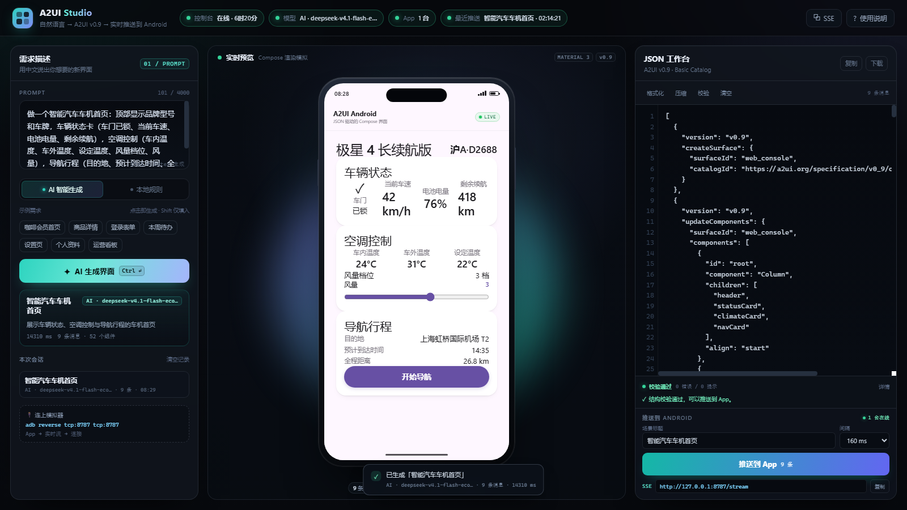
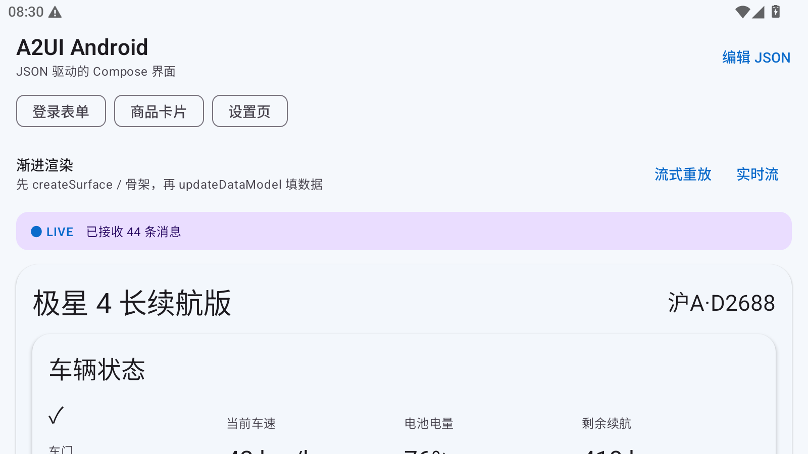

# A2UI_DEMO

用中文描述界面需求，生成 **A2UI v0.9 JSON**，通过 SSE 实时推送到 Android，用 **Jetpack Compose** 原生渲染。

网页控制台是控制面（写需求 / 看预览 / 改 JSON / 推送），Android App 只是显示端。





## 它能做什么

- **自然语言生成界面**：在浏览器里输入“一个登录页，手机号 + 验证码 + 登录按钮”，得到完整 A2UI 场景。
- **AI 优先，规则兜底**：默认调用 OpenAI 兼容接口；模型不可用、超时或返回不合法时自动回退到本地规则生成。
- **实时推送**：生成后立即预览，可手动编辑 / 校验 JSON，再按可调间隔逐条推给已连接的客户端。
- **Compose 原生渲染**：Android 端实现 A2UI Basic Catalog（`Text` `Column` `Row` `Card` `Button` `TextField` `CheckBox` `Slider` `Divider` `Image` `Icon` `List`），支持 JSON Pointer 数据绑定、列表模板和 ACTION 回传。
- **车机 HMI 模式**：从 Sketch 拆出的 1920×1200 素材按槽位确定性组装，App 端由全屏 WebView 承接。
- **示例画廊**：附带 44 个官方 A2UI 示例和 7 套车机 HMI 界面，可直接浏览对照。

```
中文需求 ──► 控制台生成 ──► A2UI JSON ──► SSE 推送 ──► Android Compose 渲染
```

## 目录

| 路径 | 说明 |
| --- | --- |
| `android-demo/` | Android App（Compose 渲染器 + WebView 车机查看器）、控制台服务与网页 UI、命令行工具 |
| `demo/` | React + Vite 画廊，`demo/server/` 是语义块编译链和 HMI 组装器 |
| `inventory/hmi-demo/` | 从 Sketch 拆出的 HMI 素材（SVG/PNG、manifest、细粒度部件） |
| `sketch-tools/` | Sketch 素材导出、画板拆解、注册表生成、资源同步脚本 |
| `a2ui/` | A2UI 协议与官方 Catalog 快照（来自 google/a2ui，Apache-2.0，见 `a2ui/NOTICE.md`） |
| `docs/screenshots/` | README 用的两张截图 |

### android-demo 内部结构

```
android-demo/
├─ console/                 网页控制台（index.html + app.js）
├─ server/
│  ├─ a2ui_console_server.py    HTTP + SSE 服务（/api/generate、/api/push、/stream）
│  ├─ a2ui_generator.py         AI / 本地规则生成 + 校验
│  └─ a2ui_stream_server.py     最小逐条下发示例
├─ tools/
│  ├─ console_push.py           命令行生成 / 推送（--hmi 走车机模式）
│  └─ hmi_live_viewer.py        一键车机预览（adb reverse + 横屏 + HmiViewerActivity）
└─ app/src/main/java/com/example/a2uidemo/
   ├─ A2uiCore.kt        A2UI 消息解析、组件表、数据模型
   ├─ A2uiCompose.kt     Basic Catalog → Compose 渲染
   ├─ StreamClient.kt    SSE 客户端
   ├─ MainActivity.kt    实时流 + 渲染
   └─ HmiViewerActivity.kt  车机 WebView
```

## 快速开始

### 1. 启动控制台

需要 Python 3.10+（只用标准库，无需 pip 安装）。

```powershell
python -u android-demo/server/a2ui_console_server.py --port 8787
```

浏览器打开 <http://127.0.0.1:8787/>，健康检查 `GET /health` 返回 `{"ok":true,"clients":N}`。

### 2. 安装 Android App

需要 JDK 17+ 和 Android SDK（`compileSdk 35`），已带 Gradle Wrapper 8.9。

```powershell
cd android-demo
.\gradlew.bat :app:installDebug      # macOS / Linux 用 ./gradlew
```

设备选择：模拟器或真机均可，`adb devices` 能看到就行。

### 3. 连上实时流

```powershell
adb -s emulator-5554 reverse tcp:8787 tcp:8787
```

App 里点右上角 **实时流**，地址保持 `http://127.0.0.1:8787/stream`，点 **连接**。
顶部出现 `LIVE` 和消息数后，控制台右下角会显示在线客户端数。

### 4. 生成并推送

左侧写需求（或点示例）→ **AI 生成界面** / **组装车机场景** → 中间预览确认 → 右侧 **推送到 App**。

## AI 模式配置

控制台读取以下环境变量；**不设置也能用**，会回退到本地规则生成。

| 变量 | 说明 |
| --- | --- |
| `A2UI_LLM_BASE_URL` | OpenAI 兼容接口地址，如 `https://api.example.com/v1` |
| `A2UI_LLM_API_KEY` | 接口密钥 |
| `A2UI_LLM_MODEL` | 模型名 |
| `A2UI_LLM_TIMEOUT_MS` | 请求超时（`demo/` 用，默认 180 秒；控制台固定 120 秒） |
| `A2UI_LLM_MAX_TOKENS` | 最大输出 token |
| `A2UI_LLM_THINKING` | 是否开启推理模式（按服务商约定） |

```powershell
$env:A2UI_LLM_BASE_URL = "https://api.example.com/v1"
$env:A2UI_LLM_API_KEY  = "<your-key>"
$env:A2UI_LLM_MODEL    = "<model-name>"
python -u android-demo/server/a2ui_console_server.py --port 8787
```

> 密钥只从环境变量读取，仓库里没有任何硬编码密钥。

## 示例画廊

```powershell
cd demo
npm install
npm run dev
```

打开 <http://127.0.0.1:5173>，左侧列出 44 个官方示例 + 7 套 HMI 车机界面；也可以直接
`http://127.0.0.1:5173/?example=05_product-card.json`。画廊顶部的“生成界面”按钮走
`A2UI_LLM_BASE` / `A2UI_LLM_MODEL`（默认 `http://127.0.0.1:8000`、`qwen3.5:4b`），细节见 `demo/README.md`。

车机 HMI 生成需要 **Node.js ≥ 22**（直接执行 `.ts`），且 `demo/` 下装过依赖。

## 接口一览

```
GET  /               控制台页面
GET  /app.js         前端脚本
GET  /stream         SSE 推送（data: <单条 A2UI 消息>）
GET  /health         探活 + 在线客户端数
GET  /api/status     服务、模型、客户端、最近推送状态
GET  /api/messages   最近一次推送的场景
POST /api/generate   {prompt, preferLlm, surfaceKind, script} -> {title, provider, messages, ...}
POST /api/validate   {messages} -> {errors, warnings, stats}
POST /api/push       {messages, title, delayMs} -> {queued, clients, messageCount, componentCount}
```

## 已知限制

- Compose 渲染器只实现 Basic Catalog；HMI 素材靠 WebView 承载。
- 车机 HMI 组装是确定性的槽位拼装，不做任意布局推理。
- 控制台按单机使用设计：没有账号体系，`/api/push` 无鉴权，不要直接暴露到公网。

## 来源与许可

- `a2ui/` 下的规范与 Catalog 来自 [google/a2ui](https://github.com/google/a2ui)，Apache-2.0，原文见 `a2ui/NOTICE.md`。
- `demo/` 依赖 `@a2ui/react` / `@a2ui/web_core`（npm 0.15.0）。
- 本仓库其余演示代码暂未声明开源许可证。